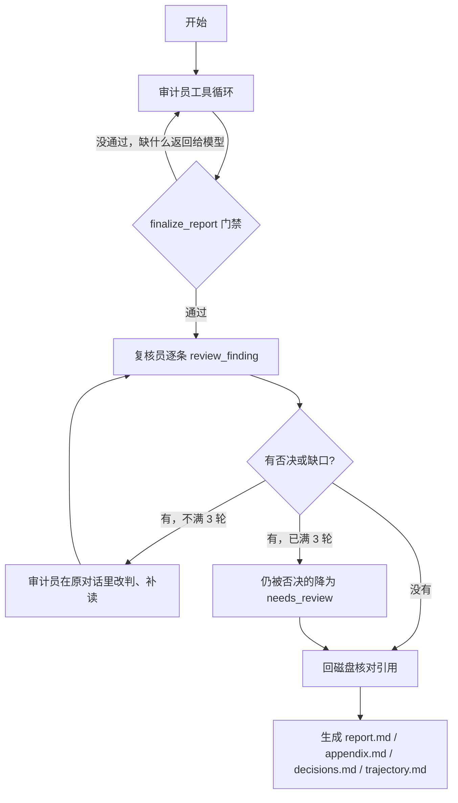

# 设计说明

## 要解决的问题

作业的核心要求有两条：调用哪些工具、按什么顺序调用由模型自己决定；从分析到出结论全程自动，不需要人插手。

我想避免写成“脚本串联”：Python 先搜一遍，再按文件列表挨个喂给模型，最后把几段回复拼成报告。那样模型其实没有选择权。现在 `src/audit_agent/agent.py` 的循环只做四件事：把对话和工具定义发给模型，执行它返回的 tool call，把结果追加回对话，等到终止工具调用成功或者步数用完就停。下一步调哪个工具，代码里没有任何分支替模型做决定。

`tests/test_agent.py` 用同一个循环跑了两种完全相反的工具顺序，断言实际执行的顺序就是模型返回的顺序。正式运行的完整调用序列记在 `meta.json` 的 `tool_sequence` 和 `trajectory.md` 里。

## 整体结构

审计员和复核员是两段独立的对话。

审计员自己用 `set_stage` 申报所处阶段（`recon`、`hunt`、`investigate`、`verify`），阶段可以来回切换。申报有前置条件，比如没列过目录就不能标侦察完成，没搜索过就不能标狩猎完成。这些条件只检查某类工作有没有做过，不规定下一步该读哪个文件。

复核员拿到的只有结构化发现的摘要，看不到审计员的推理过程。它必须对每条 confirmed / needs_review 调用 `review_finding`，调用前要用 `read_file` 读到证据前后各 10 行。还有没复核的条目时，`accept_report` 会失败。否决会记进这条发现的 `history`。审计员重写之后，复核结论清零，下一轮重新复核。

## 工具

审计员：`list_files`、`list_endpoints`、`read_file`、`search_code`、`find_references`、`pattern_scan`、`triage_leads`、`set_stage`、`upsert_finding`、`mark_reviewed`、`get_audit_state`、`resolve_gap`、`finalize_report`。

复核员：`list_files`、`list_endpoints`、`read_file`、`search_code`、`find_references`、`get_audit_state`、`review_finding`、`note_gap`（只在第一轮）、`accept_report`。

几个需要说明的工具：

- `list_endpoints`：从 `ROOT_URLCONF` 开始，顺着 `include` 递归遍历 URLconf，列出每个 URL 对应的视图、装饰器（`login_required`、`csrf_exempt` 等）、函数体里的鉴权判断、请求参数来源、写数据库的行号。目标是 Python 2 代码，`ast` 解析不了，所以只能按文本解析；解析失败的条目原样列出来，不会丢。
- `find_references`：按词边界查一个符号在哪里定义、导入、使用（模板也查）。用来确认某个配置项有没有被覆盖、某个中间件有没有真的加载。
- `upsert_finding`：上报 confirmed / needs_review 时必须填 `entry_role`，说明谁能触发这个问题：`anonymous`、`registered_open`（能自助注册）、`registered_restricted`、`privileged`、`not_applicable`。代码只检查填了没有、取值合不合法。“严重性要和入口身份对得上”这条写在提示词里，由复核员把关。
- `review_finding`：复核员必须先写 `weakest_point`（至少 15 个字），说明这条结论最可能错在哪、自己是怎么核实的，然后才能给出同意或否决。这样即使是“同意”，也会留下检查过什么的记录，最后汇总进 `decisions.md`。

没有 shell 工具，也没有“跑 PoC”的工具。审计代理一旦能执行命令，被审计仓库里的注释就有机会把它变成命令执行器。路径解析限制在检出目录里，文件内容在提示词里声明为不可信数据。

我也没有接 Semgrep：省掉一个需要单独装规则集的依赖，代价是内置规则覆盖面窄一些。模型可以用 `search_code` 自己写正则来补。

## 门禁是怎么来的

第一版（`results/run-20261020`）的问题并不是模型不调工具，而是调完工具下了错误结论，也没有任何机制逼它回头再看。我把那次运行的结果逐条过了一遍，针对每类错误加了一条约束。这些约束都是通用规则，没有把 ylinux_old 里的具体漏洞写进提示词或代码。

| 第一版的现象 | 原因 | 现在的约束 |
| --- | --- | --- |
| 没看到 `pickle.loads` 这类危险调用 | `pattern_scan` 每条规则只保留 3 条、总共 70 条，排在后面的规则被截断了 | 上限提到每条规则 500 条、总计 2000 条；同一规则在同一文件里的命中合并成一条线索（ylinux_old 大约 29 条）；每条线索都要用 `triage_leads` 处置过，`finalize_report` 才能通过 |
| 线索扫一眼就被丢掉 | 没有处置记录 | 判 `benign` 之前必须读过那个文件；判 `finding` 必须关联到已有的发现；处置理由写进 `appendix.md` |
| 读了 5–8 个文件就结束，`ylab` 等 app 根本没打开 | 覆盖门槛是固定的“读满 8 个文件” | 改成至少读过 80% 的 `views.py`，没读的列表返回给模型 |
| `reboot` 里的 `os.system` 被判成命令注入 | 只看到危险调用，没追数据从哪来 | 注入、XSS、越权、跳转、文件、反序列化这几类，标 confirmed 时必须写 `data_flow`（来源 → 中间环节 → 危险点，至少 20 个字） |
| 复核员读了文件还是照单全收 | 只要求“打开过高危证据”，不要求逐条表态 | 每条都要 `review_finding` 表态；要读到证据上下 10 行；提示词要求默认持怀疑态度 |
| 没把握的问题也被标成 confirmed | 终止条件要求“至少一条 confirmed” | 去掉这个条件；提示词里写明“不确定就标 needs_review” |
| 上下文超限时整轮对话被删掉 | 按轮次裁剪 | 只把旧的工具输出替换成 `[elided] 摘要`，保留 tool_call 的配对关系；还不够再删旧的推理内容 |
| 终止工具之后，同一批里剩下的 tool call 还在执行 | 循环里没有检查 | 终止之后的调用直接返回 `skipped` |

提示词里另外加了几条“判断方法”，而不是直接给答案：看到 `|safe` 要追这个字段是怎么生成的；配置项要确认有没有真的生效（例如 `ENGINE`、`SESSION_ENGINE`）；随机数要看用在哪里（口令盐、激活码、会话键是三回事）；只有管理员能触发的问题要降级。

## 怎么确认结果准确

一共四层，每层的结果都留在运行目录里。

1. **写入时核对。** `upsert_finding` 会把 `quote` 和声明的行号范围里的原文做比对（去掉 `12| ` 这种行号前缀，合并空白），对不上就把实际内容退回给模型。
2. **复核员。** 独立对话，逐条表态，必须读过上下文。
3. **结束后再读一次磁盘。** 每条引用回到文件里重新比对，结果写进 `verification.json`；对不上的 confirmed 降成 needs_review。
4. **对照真值离线打分。** 前三层只能证明“引用的文字确实在文件里”，证明不了分类和严重性是对的，所以加了这一层。

### 真值的来历

`eval/ground_truth.json` 不是从 Agent 的输出里抄的，但也不是安全工程师标注的。做法是：

1. 我用 Claude（和被测 Agent 用的 DeepSeek 不是同一个模型，也不在同一个会话里）逐个打开 ylinux_old 的源码，按 `文件:行` 列出真问题、可选项和容易误判的位置。生成脚本是 `eval/_build_truth.py`。
2. 另开一个独立会话，只给它仓库和这份清单，让它逐条回到源码判断：成立、不成立、行号有偏差、严重性有异议，并补上它认为漏掉的问题。结果在 `eval/ground_truth_crosscheck.json`，54 条里 49 条确认、5 条有分歧，另外补了 5 条。有分歧的条目我按源码裁决后改回了清单。
3. 最后我自己对着源码抽查了高危条目的行号和成因。

所以这份真值的可信度是“两个独立会话标注加人工抽查”，不能当成金标准。它可能和 Agent 有同样的盲点（比如大家都没想到的攻击面），这会让召回率看起来偏高。

还有一点要说明：提示词和门禁是在 ylinux_old 上迭代出来的。上一节的约束是看了第一版的错误之后才加的。规则本身写得很通用，但它们唯一被验证过的场景就是这个仓库，所以 ylinux_old 上的分数相当于“训练集分数”。为了看泛化效果，我把代码和提示词冻结后又跑了 django.nV，见后面“第二个目标”一节。

清单内容：

- **32 个真问题**（GT-01…GT-32），每条带严重性和精确的 `文件:行`。比如 Markdown 没开 `safe_mode` 再经 `|safe` 输出的存储型 XSS、`editPostAJAX` 不校验归属、XML-RPC 任意登录用户都能 `Topic.objects.all().delete()`、重置 key 只有 5 位十六进制的盐、重置接口接受字面量 `ALREADY_ACTIVATED`、全站没有 CSRF 中间件。GT-31（XML-RPC 认证不检查 `is_active`）和 GT-32（附件可以挂到任意主题）是交叉核对时补进来的。
- **9 个可选项**：问题是真的，但比较边缘（比如实体膨胀 DoS 要看 expat 版本，邮件正文 XSS 要看邮件客户端）。命中算真阳性，漏掉不扣召回。
- **18 个误报陷阱**：已知容易判错的位置，以及错在哪里。比如把 `reboot` 里的 `os.system` 判成 `injection`；`get_group_permissions` 里的 `%` 其实只拼了标识符；pickle 会话后端判到 medium 以上；上传文件名判成路径穿越（框架已经取过 basename）。

交叉核对还调整了三条严重性：GT-07 从 critical 降到 high（需要先登录），GT-11 从 high 降到 medium，GT-15 从 medium 降到 low。

标注过程中有两处推翻了我之前的判断：

- **我原来以为“会话 pickle 反序列化”是最大的漏报，其实不是。** 项目自己的 `SessionMiddleware` 按 `settings.SESSION_ENGINE` 加载后端，而 `settings.py` 没有设置这一项，用的就是 Django 默认的 `django.contrib.sessions.backends.db`，项目里 `app/sessions/backends/*` 下的代码并没有被用上。另外，会话数据存在服务端，cookie 里只有会话键，攻击者控制不了被反序列化的内容。所以现在它是误报陷阱 FP-03（判 medium 以上算误报），同时作为 info 级的可选项 OPT-05。
- 我原来以为 `Post.save` 的 markdown 分支用了 `safe_mode='escape'`，`|safe` 不一定能构成 XSS。实际上所有发帖路径都把 `markup` 写死成 `'none'`，走的是没有 safe_mode 的那条分支，`escape` 那条分支根本走不到。XSS 成立，而且是 high。

另外，生产环境用的 `scripts/ylinux.fcgi:21` 加载的是 `ylinux.ysettings`，这个文件不在仓库里，所以 `settings.py` 里 DEBUG、密钥这类配置问题的结论只对仓库里的配置成立。

### 打分规则

代码在 `src/audit_agent/evaluate.py`，只给 confirmed 和 needs_review 打分：

- 发现的任一证据区间和真值的任一位置在同一个文件、行号相差不超过 3 行，就算命中。类别要等于真值的主类别或它列出的备选类别（`also_categories`）之一：同一个缺陷归到两个类别都说得通，但不检查类别的话，一条讲限速的发现引用了登录视图，也会被算成命中三行之外的开放跳转。
- 误报陷阱按精确行号匹配。带条件的陷阱（错误类别、错误 CWE、严重性下限）优先于真值命中。例如 `reboot` 那两行既是真问题 GT-14（GET 请求能触发危险操作），又是陷阱 FP-01：判成 `csrf` 算命中，判成 `injection` 算误报。
- 输出这几项指标：
  - 精确率下限：没匹配上的发现有可能是真值没收录的真问题，所以只给下限。
  - 召回率。
  - high 及以上的召回率。
  - 按严重性加权的召回率（critical=5 … info=1）。
  - 每条发现的严重性偏差：和真值相差超过一级，记为 over 或 under。

### 分数

逐条判定在 `results/EVALUATION.md`，每个运行目录里还有一份 `REVIEW.md`。按发现合并、对着源码讲解的版本是 [REPORT.md](REPORT.md)。

| 运行 | 说明 | 用时 | 上报 | 精确率下限 | 召回率 | high 及以上召回 | 加权召回 |
| --- | --- | --- | --- | --- | --- | --- | --- |
| `run-20261020` | DeepSeek-V3，还没有门禁 | — | 7 | 0.857 | 0.188 | 0.5 | 0.227 |
| `run-20261021` | v4-pro，还没加 `list_endpoints` / `entry_role` / `weakest_point` | 11 min | 15 | 1.0 | 0.688 | 1.0 | 0.727 |
| `run-20261021-r1` | 当前代码 | 14 min | 15 | 1.0 | 0.562 | 1.0 | 0.625 |
| `run-20261021-r2` | 当前代码 | 12 min | 12 | 0.917 | 0.531 | 1.0 | 0.602 |
| `run-20261021-r3` | 当前代码 | 16 min | 16 | 0.938 | 0.625 | 1.0 | 0.682 |
| r1–r3 均值 ± 标准差 | | | 14.3 ± 2.1 | 0.952 ± 0.043 | 0.573 ± 0.048 | 1.0 ± 0 | 0.636 ± 0.041 |
| `run-20261021-kimi` | 复核员换成 kimi-k3 | 32 min | 19 | 0.947 | 0.625 | 1.0 | 0.693 |
| `run-20261021-kimi2` | 同上，复核第 2 轮中断 | 23 min | 13 | 0.923 | 0.5 | 1.0 | 0.568 |
| `run-20261021-kimi3` | 同上，复核第 1 轮中断 | 23 min | 15 | 0.933 | 0.531 | 1.0 | 0.602 |
| kimi 三次均值 ± 标准差 | | | 15.7 ± 3.1 | 0.934 ± 0.012 | 0.552 ± 0.065 | 1.0 ± 0 | 0.621 ± 0.065 |

kimi2、kimi3 跑到复核阶段时 Moonshot 账户余额用完，接口返回 429 `exceeded_current_quota_error`。审计员部分是完整的，复核只做了一部分（kimi2 有 4 条、kimi3 有 8 条上报的发现没来得及复核），报告开头标了“中途中断”，没复核的条目标为“未复核”。召回主要取决于审计员（复核员只能通过提缺口间接影响），所以这两次仍然可以拿来看召回的波动；复核员的表现只看已经复核过的条目。

几点观察：

- **跑一次说明不了问题。** 审计员配置完全相同的 6 次运行（r1–r3、kimi1–3），召回率在 0.50 到 0.625 之间，均值 0.56 ± 0.05。`run-20261021` 的 0.688 在这个范围之外，但只有一次，我不认为它说明旧版本更好。后来加的 `list_endpoints`、`find_references` 有没有提升召回，我测不出来，也不打算这么说。它们的用处是让 `entry_role` 有依据可查。每次运行 `list_endpoints` 只调用一次，`find_references` 调用 0 到 3 次。
- **高危稳定，低危和逻辑漏洞不稳定。** 6 条 high 在每次新版运行里都找到了。6 次都没找到的 8 条里，最难的是 GT-11（重置接口接受字面量 `ALREADY_ACTIVATED`）和 GT-12（重置 key 不过期），这两条要把激活和重置两段代码对起来看才能发现。剩下的是 low 级问题，比如用户枚举、X-Forwarded-For、请求体打到 stdout、没有防暴力破解。
- **反复出现的误报有两类。** 一是 FP-05：附件上传被判成 high 级的“路径穿越任意写入”，但 Django 的 `UploadedFile.name` 已经取过 basename。审计员 6 次都报了，其中 5 次定成 high、1 次 medium。同模型复核员三次都同意，Kimi 三次都否决（见下一节）。r1 那一条同时覆盖了真问题 GT-32，所以记为命中，只是严重性偏高（over）。二是 FP-03：kimi2、kimi3 把没启用的 pickle 会话后端报成 medium，这两条刚好都在复核中断后没被复核到；其余运行要么没报，要么报成 low。
- **没有“未匹配”的发现。** 所有上报都落在真值、可选项或陷阱上，所以精确率下限就是实际精确率，前提是真值本身没错。

### 换模型复核

审计员都是 `deepseek-v4-pro`，复核员换成 Moonshot 的 `kimi-k3`，通过 `AUDIT_CRITIC_*` 环境变量配置。ylinux_old 上跑了 3 次（kimi、kimi2、kimi3），django.nV 上跑了 1 次（`nv-20261021-kimi`）。后三次都在复核阶段因为余额用完中断，下表只统计已经提交的复核。

| 复核员 | 运行 | 复核次数 | 否决 | 缺口 |
| --- | --- | --- | --- | --- |
| deepseek-v4-pro | ylinux_old 4 次 + django.nV 1 次 | 80 | 0 | 7 |
| kimi-k3 | ylinux_old 3 次 + django.nV 1 次（3 次中断） | 59 | 6 | 6 |

DeepSeek 当复核员时一次都没否决过。Kimi 的 6 次否决都在 ylinux_old 上，大部分有依据：

- **FP-05（附件上传“路径穿越”），3 次运行 3 次否决。** 审计员两次报 high、一次报 medium，Kimi 每次都读到 `UploadedFile` 会取 basename。kimi 那次审计员改成 needs_review / low，kimi2 那次直接改成 rejected。kimi3 中断在第 1 轮，来不及改判，停在 disputed，不计入上报。同一个错误在 DeepSeek 复核下 3 次都被同意了。
- **严重性调整 3 条。** `ACCESS-003`（附件下载）认为影响写大了，审计员补查读取路径后新增了 `ACCESS-004`，命中 GT-08；kimi3 的 `XSS-004`（ylab 上传回显）认为只是 self-XSS，应降为 low；kimi2 的 `ACCESS-002`（XML-RPC 删全站主题）认为 medium 定低了，应升为 high。这条否决方向是对的（真值是 high）。
- **漏掉的方面。** kimi2、kimi3 里报成 medium 的 pickle 会话（FP-03）刚好都在中断后没复核到，所以不知道 Kimi 会不会拦。django.nV 上 Kimi 0 否决，同意了两条踩中陷阱的发现（`ALLOWED_HOSTS` 报成 medium；改口令接口的 `csrf_exempt`），说明它也会放过。

django.nV 上 Kimi 提的 3 个缺口都被审计员补上了，其中“注册表单可以直接设 `is_superuser`”命中了 critical 级的 NV-04，审计员第一遍没报这条。ylinux_old 上 kimi2 的缺口（上传不限类型、同源可访问）补出了 `XSS-002`，命中 GT-05、GT-23。DeepSeek 复核员也会提缺口，r1 的缺口带来了 GT-08。缺口是复核员能提高召回的唯一途径，因为召回率本身只取决于审计员写了什么。

代价是用时：ylinux_old 完整跑一次 Kimi 复核要 32 分钟（3 轮往返），是同模型复核的两倍。

结论：同一个模型复核自己基本是走过场；换一个模型后，FP-05 这种审计员反复犯的错 3 次都被拦住了。样本还是小（4 次、3 次中断），所以默认配置仍然只要一个密钥，但 README 里推荐复核员换模型。

### 可复现性

每次运行都会把模型响应的原文写进 `llm_responses.jsonl`。执行 `python -m audit_agent replay results/run-20261021-r3` 不需要密钥：它用录下来的 92 条响应重新驱动同一个循环，工具在本地真实执行，大约 1.5 秒跑完。重放出来的发现、工具序列和核对结果都和原运行一致。如果 `workspace/` 里还没有目标仓库，会先按记录的 commit 克隆。中断的运行（kimi2、kimi3、nv-kimi）也能重放：录下的响应用完时，原运行正好也停在那里，重放出来的发现和原运行一致。

## 第二个目标：django.nV

为了看这些规则是不是只对 ylinux_old 管用，我冻结了代码和提示词，又跑了 [nVisium/django.nV](https://github.com/nVisium/django.nV)（commit `a48901f106da4888417339b7b44b8ed56b64c63f`），这是一个故意留了漏洞的 Django 1.8 教学项目。命令只多了 `--local`、`--target-*` 和 `--vendor ""` 几个参数，提示词和门禁一个字没改。

真值 `eval/django_nv_truth.json` 是在 Agent 跑之前另开一个 Claude 会话标注的，标注时看不到 Agent 的任何输出。内容是 24 个真问题、4 个可选项、16 个误报陷阱。我对着源码抽查了 NV-01/03/04/05/07 的行号。

| 运行 | 复核员 | 用时 | 上报 | 精确率下限 | 召回率 | high 及以上召回 | 加权召回 |
| --- | --- | --- | --- | --- | --- | --- | --- |
| `nv-20261021` | deepseek-v4-pro | 15 min | 22 | 1.0 | 0.958 | 0.923 | 0.956 |
| `nv-20261021-kimi` | kimi-k3（第 2 轮中断） | 24 min | 19 | 0.895 | 0.833 | 0.923 | 0.856 |

`nv-20261021` 唯一的漏报是 NV-13：笔记的创建、编辑、删除存在 IDOR。同类的项目和任务 IDOR 都找到了，笔记没有单独列出来。另有两条严重性偏低：

- 会话 cookie 没设 HttpOnly 被定成 low。它命中的 NV-03 是 critical，指的是签名 cookie + pickle 会话。两者是同一处配置，Agent 另外有一条 `SESSION-001` 按 critical 报了这个问题。
- Django 1.8.3 版本过期被定成 info，真值是 medium。

`nv-20261021-kimi` 少了 3 条：NV-13 同样漏掉；NV-21（Django 版本过期）和 NV-23（任务详情读侧 IDOR）这次审计员没报。NV-18（DEBUG=True）其实报了，但同一条发现把 `ALLOWED_HOSTS=[]` 说成 medium 级的 Host 头问题，踩中了陷阱 NVFP-13，整条按误报计。另一条误报是把改口令、找回口令接口的 `csrf_exempt` 报成 CSRF（NVFP-01/02），这两个接口要么需要旧口令，要么不借用受害者身份。两条 Kimi 都同意了。

两次的差距和 ylinux_old 上的波动幅度差不多，主要来自审计员这次少报了几条，不是换复核员导致的。

这个分数要打折看。django.nV 是教学项目，源码里有 `A1`、`A2` 这种 OWASP 编号注释，直接标出了漏洞的位置，难度比真实项目低很多。它能说明规则没有针对 ylinux_old 的具体文件过拟合，但不能说明 Agent 在真实代码上能有 0.83–0.96 的召回率。

## 模型和接口

| 项 | `run-20261020` | 其余所有运行 | `*-kimi*` 的复核员 |
| --- | --- | --- | --- |
| 模型 | SiliconFlow `deepseek-ai/DeepSeek-V3`（当时官方账户余额不够） | DeepSeek 官方 `deepseek-v4-pro`（审计员和复核员都用它） | Moonshot `kimi-k3` |
| 接口 | `https://api.siliconflow.cn/v1` | `https://api.deepseek.com` | `https://api.moonshot.cn/v1` |
| 推理 | 不开，temperature 0.2，max_tokens 4096 | `reasoning_effort=max`，max_tokens 32768，不传 temperature | 不传 `reasoning_effort` |
| 预算（审计员 / 复核 / 退回 / 轮数） | 40 / 12 / 18 / 2 | 80 / 40 / 40 / 3 | 同左 |

复核员可以用 `AUDIT_CRITIC_MODEL`、`AUDIT_CRITIC_BASE_URL`、`AUDIT_CRITIC_API_KEY`、`AUDIT_CRITIC_REASONING_EFFORT` 单独配置，不填就和审计员用同一套。`meta.json` 分角色记录模型、接口和 token 用量。

`deepseek-v4-pro` 的思考内容在 `reasoning_content` 里返回。客户端会把它跟着 assistant 消息一起传回去（接口允许这么做）。压缩上下文时，先删旧的推理内容，再删旧的工具输出。用量里的 `prompt_cache_hit_tokens` 和 `reasoning_tokens` 也记进了 `meta.json`，可以看出多轮工具调用下前缀缓存的命中比例。

接口错误按类型处理：

- 连接错误、超时、408/409/429/5xx：指数退避，最多重试 5 次。
- 余额不足：有的网关也返回 429（Moonshot 是 `exceeded_current_quota_error`），等多久都不会恢复，所以按错误信息识别出来后直接失败，不重试。
- 运行中途失败：已经写入的发现照样做引用核对、生成报告，报告开头注明中断，没复核到的条目标“未复核”。kimi2、kimi3、nv-kimi 就是这么保留下来的。
- 上下文超限：抛 `ContextTooLong`，循环把压缩预算减半后重试一次。

## 取舍

- **不启动 Django。** 依赖是十几年前的 Python 2 技术栈，硬跑起来不但缺包，还会在本机拉起一个没审计过的老 Web 服务。代价是所有结论都只来自静态分析，`needs_review` 就是为这类拿不准的情况准备的。
- **默认跳过第三方和静态目录。** `static`、`assets`、`vendor`、`third_party` 这类目录名，以及以 `media` 结尾的目录（比如 `ymedia`）总是跳过，`node_modules` 和 `.git` 直接忽略。项目自己特有的目录用 `--vendor` 或 `AUDIT_VENDOR_DIRS` 指定（默认 `lib/markdown`，django.nV 传空）。代价是 Markdown 的 `safe_mode` 默认值，得靠模型自己去读 `lib/markdown/__init__.py` 才能确认。所有工具都接受 `include_vendor=true`，`read_file` 也照样能打开这些文件。
- **门禁只卡“做没做”，不卡“结论对不对”。** 线索处置、views 覆盖率、`data_flow`、`entry_role`、逐条复核和 `weakest_point`，检查的都只是对应的工作有没有做。这能逼模型回头看，但挡不住它看完还是判错：FP-05 在三次重复运行里都通过了全部门禁和同模型复核。这类错误只能靠另一个模型复核和离线打分发现，而且换了模型也不是全能拦住（Kimi 在 django.nV 上同意了两条踩陷阱的发现）。
- **门禁越多，步数越多。** 一次运行要调 160–257 次工具，用 3.1–7.9M prompt token。`deepseek-v4-pro` 开 `max` 思考要 11–16 分钟，换 Kimi 复核要 32 分钟。前缀缓存命中率在 94%–97%，省掉了大部分费用。
- **同一个模型复核自己，基本不会否决。** 独立对话能去掉审计员的上下文惯性，但去不掉模型本身的倾向。DeepSeek 复核了 80 次，否决 0 次；Kimi 复核 59 次，否决 6 次，FP-05 三次都拦住了。我仍然没有把 Kimi 设为默认复核员：默认配置只要一个密钥就能跑通，而 Kimi 的样本只有 4 次、其中 3 次中断。README 里推荐有条件就换模型。
- **真值本身也可能有错。** 它由两个独立会话标注、交叉核对，再加我的抽查，没有安全工程师复核过。所以没匹配上的发现只算进精确率下限，不直接当成误报。遇到这种发现要人工判断，有必要就补进真值。
- **ylinux_old 的分数是训练集分数。** 规则是在它上面调出来的。django.nV 是唯一的泛化检验，而且源码里有提示漏洞的注释。更可信的做法是找一个没有这类注释、事先由人工标注好的真实项目来测，这次没有做。
- **打分结论不回写 Agent 的结果。** `findings.json` 只包含模型写入并通过核对的内容。打分的判断只出现在 `evaluation.json`、`REVIEW.md`、`results/EVALUATION*.md` 和这份文档里。这样能看清模型实际做到了哪一步。
