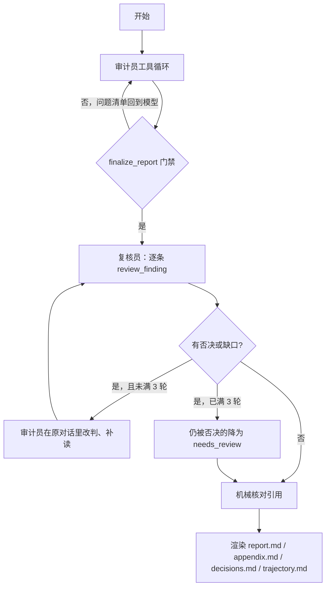

# 设计说明

## 目标

作业要求两件事：模型自己决定调用哪些工具、以什么顺序调用；从开始分析到最终结论自动走完。目标是 [gwind/ylinux_old](https://github.com/gwind/ylinux_old)，commit `8a7316deec88287d020eca21c38dad921b623ffc`，一个 2010–2011 年的 Django 1.2 / Python 2 社区站点。

“脚本串联”指的是这种形状：Python 先搜索，再按文件列表循环调用模型，最后把几段回复拼成报告。那种程序里模型没有选择权。`src/audit_agent/agent.py` 只做这几件事：把对话和工具 schema 发给模型，执行它返回的 tool call，把观察追加回去，在终止工具成功或步数用尽时停下。下一次调用什么，代码里没有分支。

`tests/test_agent.py` 用同一个循环跑两种相反的工具顺序，断言轨迹就是模型返回的顺序。正式运行的完整序列在 `meta.json` 的 `tool_sequence` 和 `trajectory.md` 里。

## 环节

审计员的四个阶段名 `recon`、`hunt`、`investigate`、`verify` 由模型用 `set_stage` 自己申报，可以穿插。申报有前置条件（没列目录不能标侦察完成、没搜索不能标狩猎完成等），卡的是“有没有做过这类工作”，不规定下一步读哪个文件。

复核员是另一段新对话，只拿到结构化发现的摘要包。它必须对每条 confirmed / needs_review 调用 `review_finding`，并且调用前要用 `read_file` 覆盖证据上下各 10 行；`accept_report` 在还有未复核条目时失败。否决会写进发现的 `history`，审计员重写该发现后复核结论清零，下一轮要重新复核。

## 工具

审计员：`list_files`、`list_endpoints`、`read_file`、`search_code`、`find_references`、`pattern_scan`、`triage_leads`、`set_stage`、`upsert_finding`、`mark_reviewed`、`get_audit_state`、`resolve_gap`、`finalize_report`。

复核员：`list_files`、`list_endpoints`、`read_file`、`search_code`、`find_references`、`get_audit_state`、`review_finding`、`note_gap`（仅第一轮）、`accept_report`。

- `list_endpoints` 从 `ROOT_URLCONF` 出发，按 `include` 递归遍历 URLconf，给出每个 URL 对应的视图、装饰器（`login_required`、`csrf_exempt` 等）、函数体里的鉴权检查、请求输入来源、写操作行号和启发式标记。目标是 Python 2 代码，`ast` 解析不了，所以用文本方式解析；解析不了的条目原样列出，不丢弃。
- `find_references` 按词边界查一个符号的定义、导入、使用（含模板），用于确认“某个配置项是否被覆盖”“某个中间件是否真的加载”这类问题。
- `upsert_finding` 要求上报（confirmed / needs_review）的发现写 `entry_role`：`anonymous`、`registered_open`（可自助注册）、`registered_restricted`、`privileged`、`not_applicable`。代码只检查“填了且取值合法”；“严重性要和入口身份一致”写在提示词里，由复核员核对（`entry_role 与代码不符` 是否决理由之一）。这是对上一版“管理员才能触发的问题被定成 high”的通用修正。
- `review_finding` 要求复核员先写 `weakest_point`（≥15 字）：这条结论最可能错在哪、怎么核对的，再给同意或否决。目的是让“同意”也必须留下检查过什么的记录，写进 `decisions.md`。

没有 shell，也没有“跑 PoC”的工具。审计代理如果能执行命令，仓库里的注释就有机会把它变成命令执行器。路径解析限制在检出目录内，文件内容在提示词里声明为不可信数据。没有依赖 Semgrep：少一个要单独安装规则集的组件，换来规则更窄；模型可以用 `search_code` 写自己的正则。

## 门禁：为什么这样设计

第一版的问题不是“模型没调工具”，而是“调完工具后下了错结论，且没有机制逼它回头”。下表是对上一次运行（`results/run-20261020`）逐条复盘后加的约束。每一条都是通用规则，没有把 ylinux_old 的具体漏洞写进提示词或代码。

| 上一次运行的现象 | 原因 | 现在的约束 |
| --- | --- | --- |
| `pickle.loads` 等汇点没被看到 | `pattern_scan` 每条规则只留 3 条、总共 70 条，排在后面的规则被截断 | 上限提到每规则 500 / 总计 2000；同一规则同一文件的命中合并成一条**线索**（ylinux_old 约 29 条）；`finalize_report` 要求每条线索都被 `triage_leads` 处置 |
| 线索可以被“看一眼”就丢掉 | 没有处置记录 | 判 `benign` 前必须读过该文件；判 `finding` 必须关联已存在的发现；处置理由写进报告第 8 节 |
| 读了 5–8 个文件就结束，`ylab` 等 app 没打开 | 覆盖门槛是固定的“读满 8 个文件” | 改为读过至少 80% 的 `views.py`，未读的列表回给模型 |
| `reboot` 里的 `os.system` 被判为命令注入 | 只看到汇点，没追来源 | 注入、XSS、越权、跳转、文件、反序列化类的 confirmed 必须填 `data_flow`（来源 → 传递 → 汇点，≥20 字符） |
| 复核员读了文件仍然照单全收 | 只要求“打开过高危证据”，不要求逐条表态 | `review_finding` 逐条同意/否决；要求读到证据上下 10 行；提示词默认怀疑 |
| 把握不足的问题被升成 confirmed | 终止条件要求“至少一条 confirmed” | 删除该门槛；提示词明确“不确定就 needs_review” |
| 上下文超限时整轮对话被删 | 按轮次裁剪 | 只把旧工具输出替换为 `[elided] 摘要`，保留 tool_call 配对；再不够才去掉旧的推理内容 |
| 停止工具之后同一批 tool call 仍被执行 | 循环没检查 | 停止之后的调用返回 `skipped` |

提示词另外加了几条“判断方法”而不是“答案”：看到 `|safe` 要追字段是怎么生成的；配置项要确认是否生效（例如 `ENGINE`、`SESSION_ENGINE`）；随机数要看用在哪里（口令盐、激活码、会话键是三件事）；仅管理员可触发的问题要降级。

## 准确性怎么验证

分四层，结果都留在运行目录里。

1. **写入时核对。** `upsert_finding` 把 `quote` 和声明行号范围内的原文比对（剥掉 `12| ` 行号前缀、折叠空白），对不上就退回实际内容。
2. **复核员。** 独立对话、逐条表态、必须读上下文。
3. **结束后再读磁盘。** `verification.json` 记录每条引用；对不上的 `confirmed` 降为 `needs_review`。
4. **对照真值离线打分。** 这是新增的一层，前三层只能证明“引用的文字确实在文件里”，不能证明分类和严重性对。

### 真值从哪来（如实说明）

`eval/ground_truth.json` 不是从 Agent 输出里抄的，但也**不是人类安全工程师标注的**。实际过程：

1. 开发助手（Claude，与被测 Agent 不同的会话、不同的模型）逐条打开 ylinux_old 源码，按 `文件:行` 写出真问题、可选项和误报陷阱，生成脚本是 `eval/_build_truth.py`。
2. 另起一个独立子代理，只给它仓库和真值清单，要求逐条回到源码判断“成立 / 不成立 / 行号偏差 / 严重性有异议”，并补充它认为漏掉的问题。结果在 `eval/ground_truth_crosscheck.json`，有分歧的条目已按源码裁决并回写。
3. 主会话再对高危条目手工抽查行号和成因。

所以真值的可信度是“两个独立的模型标注 + 抽查”，不是人工金标准。它可能和 Agent 共享同一类盲点（例如都没想到的攻击面），这会让召回率偏高。

另一点需要披露：**提示词和门禁规则是在 ylinux_old 上迭代出来的**。上一版运行的错误逐条复盘后才加了现在的约束（见上一节表格），规则写的是通用方法，但它们被验证有效的唯一场景就是这个仓库。ylinux_old 上的分数因此是“训练集分数”。为了看泛化，又用冻结后的代码和提示词跑了第二个目标 django.nV（见“第二个目标”一节），它的真值 `eval/django_nv_truth.json` 由另一个独立子代理在 Agent 运行前标注。

内容：

- **32 个真问题**（GT-01…GT-32），每个带严重性和精确的 `文件:行` 位置。例如 Markdown 未开 `safe_mode` 后经 `|safe` 输出的存储型 XSS、`editPostAJAX` 不校验归属、XML-RPC 任意认证用户可 `Topic.objects.all().delete()`、重置 key 只有 5 位十六进制盐、字面量 `ALREADY_ACTIVATED` 能通过重置接口、全站没有 CSRF 中间件。GT-31（XML-RPC 认证不检查 `is_active`）和 GT-32（附件可挂到任意主题）是交叉核对时补进来的。
- **9 个可选项**：真实但边缘（如实体膨胀 DoS 取决于 expat 版本、邮件正文 XSS 取决于客户端），命中算真阳性，漏掉不扣召回。
- **18 个误报陷阱**：已知容易被判错的位置及“错在哪里”。例如 `reboot` 的 `os.system` 判成 `injection` 就是错；`get_group_permissions` 的 `%` 只拼标识符；pickle 会话后端判到 medium 以上就是错；上传文件名判成路径穿越是错（框架已取 basename）。

交叉核对还改了三条严重性：GT-07 critical → high（需要登录），GT-11 high → medium，GT-15 medium → low。

标注时有两点改变了对上一版文档的结论：

- **上一版 DESIGN.md 把“会话 pickle 反序列化”列为最大漏报，这是错的。** `settings.py` 没有设置 `SESSION_ENGINE`，中间件加载的是 Django 自带的 `django.contrib.sessions.backends.db`，项目自己的 `app/sessions/backends/*` 根本没被使用；而且会话数据存在服务端，cookie 里只有会话键，攻击者控制不了被反序列化的字节。现在它是误报陷阱 FP-03（判 medium 以上算误报），同时作为 info 级可选项 OPT-05。
- 上一版说 `Post.save` 的 markdown 分支用了 `safe_mode='escape'`，所以 `|safe` 不能直接确认 XSS。实际上所有发帖路径都强制 `markup='none'`，走的是没有 safe_mode 的分支，那个 `escape` 分支不可达。XSS 成立，且是 high。

另外，生产用的 `scripts/ylinux.fcgi:21` 加载 `ylinux.ysettings`，这个文件不在仓库里，所以 `settings.py` 里的 DEBUG、密钥等配置类结论只对仓库配置成立。

### 打分规则

`src/audit_agent/evaluate.py`，只对 `confirmed` 和 `needs_review` 打分：

- 发现的任一证据区间与真值的任一位置在同一文件、行号相差 3 行以内，就算命中。不要求类别一致，因为同一个缺陷可以合理地归到两类。
- 误报陷阱按精确行匹配。带条件的陷阱（错误类别、错误 CWE、严重性下限）优先于真值命中：`reboot` 那两行既是真问题 GT-14（GET 触发危险操作），又是陷阱 FP-01；判成 `csrf` 算命中，判成 `injection` 算误报。
- 输出精确率下限（未匹配的发现可能是真值没收录的真问题，所以只给下限）、召回率、high 及以上召回率、按严重性加权召回率（critical=5 … info=1），以及每条发现的严重性偏差（相差超过一级记 over / under）。

### 分数

逐条判定在 `results/EVALUATION.md`，每个运行目录另有 `REVIEW.md`。

| 运行 | 说明 | 用时 | 上报 | 精确率下限 | 召回率 | high 及以上召回 | 加权召回 |
| --- | --- | --- | --- | --- | --- | --- | --- |
| `run-20261020` | DeepSeek-V3，门禁加入前 | — | 7 | 0.857 | 0.188 | 0.5 | 0.227 |
| `run-20261021` | v4-pro，未加 `list_endpoints` / `entry_role` / `weakest_point` | 11 min | 15 | 1.0 | 0.688 | 1.0 | 0.727 |
| `run-20261021-r1` | 当前代码 | 14 min | 15 | 1.0 | 0.562 | 1.0 | 0.625 |
| `run-20261021-r2` | 当前代码 | 12 min | 12 | 0.917 | 0.531 | 1.0 | 0.602 |
| `run-20261021-r3` | 当前代码 | 16 min | 16 | 0.938 | 0.625 | 1.0 | 0.682 |
| r1–r3 均值 ± 标准差 | | | 14.3 ± 2.1 | 0.952 ± 0.043 | 0.573 ± 0.048 | 1.0 ± 0 | 0.636 ± 0.041 |
| `run-20261021-kimi` | 当前代码，复核员换成 kimi-k3 | 32 min | 19 | 0.947 | 0.625 | 1.0 | 0.693 |

怎么读这张表：

- **单次运行不能下结论。** 同一份代码、同一模型重复 3 次，召回率在 0.531–0.625 之间。`run-20261021` 的 0.688 落在这个波动范围的上沿附近，所以后来加的 `list_endpoints`、`find_references` 没有带来**可测量的**召回提升，这里不声称它们有效。它们的作用是让入口身份（`entry_role`）有据可查，每次运行 `list_endpoints` 只被调用一次，`find_references` 0–3 次。
- **高危稳定，低危和逻辑类不稳定。** 6 条 high 在所有新版运行里都被找到。3 次都漏掉的 10 条里，GT-11（重置接口接受字面量 `ALREADY_ACTIVATED`）和 GT-12（重置 key 不过期）需要把激活和重置两段代码连起来看，是最难的；其余多是 low 级信息类（用户枚举、X-Forwarded-For、请求体打到 stdout）。
- **唯一反复出现的误报是 FP-05。** r1、r2、r3 都把附件上传判成“路径穿越任意写”并定为 high，但 Django 的 `UploadedFile.name` 已经取了 basename。同模型复核员三次都同意了。r1 那条同时覆盖了真问题 GT-32，所以记为命中但严重性 over。
- **精确率是下限，但这里没有“未匹配”。** 所有上报都落在真值、可选项或陷阱上，所以下限就是实际值；前提是真值本身没错。

### 换模型复核

`run-20261021-kimi` 的审计员仍是 `deepseek-v4-pro`，复核员换成 Moonshot 的 `kimi-k3`（`AUDIT_CRITIC_*` 环境变量）。

| 复核员 | 复核次数 | 否决 | 缺口 |
| --- | --- | --- | --- |
| deepseek-v4-pro（ylinux_old 4 次运行 + django.nV 1 次） | 80 | 0 | 7 |
| kimi-k3（1 次运行，3 轮往返） | 21 | 2 | 2 |

同模型复核员从未否决过任何一条。Kimi 否决了两条，都是严重性：

- `FILE-001` 路径穿越：Kimi 读到 `UploadedFile` 的 basename 处理后否决，审计员改为 `needs_review` / low，标题改成“依赖框架 basename 清洗的纵深防御项”。这正是 r1–r3 里同模型复核员三次放过的 FP-05。按打分规则它仍算踩中陷阱（判定只看位置和类别），但严重性已经不再误导人。
- `ACCESS-003` 附件下载无访问控制：Kimi 认为影响写大了。审计员在回应时补查了读取路径，新增 `ACCESS-004`（受限版块的主题、帖子、附件匿名可读），命中了 GT-08（r1–r3 里只有 r1 找到过）。

代价是用时翻倍（32 分钟，3 轮往返），复核员消耗 1.40M prompt / 39.7k completion token。只有一次运行，不能说 Kimi 复核一定提高召回；能说的是：同模型复核在这个任务上几乎是橡皮图章，换模型后至少出现了真实的分歧。

### 可复现性

每次运行把模型响应原文写进 `llm_responses.jsonl`。`python -m audit_agent replay results/run-20261021-r3` 不需要密钥，用这 92 条录下的响应重新驱动同一个循环；工具在本地真实执行，约 1.5 秒跑完，产出的发现、工具序列、核对结果与原运行一致。如果工具实现改了导致观察不同，重放仍按录下的响应走，但会在结果里看出差异。

## 第二个目标：django.nV

为了看规则是否只对 ylinux_old 有效，冻结代码和提示词后跑了 [nVisium/django.nV](https://github.com/nVisium/django.nV)（commit `a48901f106da4888417339b7b44b8ed56b64c63f`，Django 1.8 的故意含漏洞教学应用）。命令只多了 `--local`、`--target-*` 和 `--vendor ""`，没有改任何提示词或门禁。

真值 `eval/django_nv_truth.json` 由另一个独立子代理在 Agent 运行前标注，不看 Agent 输出：24 个真问题、4 个可选项、16 个误报陷阱；主会话抽查了 NV-01/03/04/05/07 的行号。

| 运行 | 用时 | 上报 | 精确率下限 | 召回率 | high 及以上召回 | 加权召回 |
| --- | --- | --- | --- | --- | --- | --- |
| `nv-20261021` | 15 min | 22 | 1.0 | 0.958 | 0.923 | 0.956 |

唯一漏报是 NV-13（备注的创建 / 编辑 / 删除 IDOR）；同类的项目、任务 IDOR 找到了，备注没有单独列出。两条严重性偏低：会话 cookie 未设 HttpOnly 定为 low，而它命中的 NV-03 是 critical 的签名 cookie + pickle 会话（同一处配置，Agent 另有一条 `SESSION-001` 按 critical 报了这个问题）；Django 1.8.3 过期定为 info，真值是 medium。

这个分数要打折看：django.nV 是教学项目，源码里有 `A1`、`A2` 这类 OWASP 编号注释直接标出漏洞位置，难度明显低于真实项目。它能说明规则没有过拟合到 ylinux_old 的具体文件，不能说明 Agent 在真实代码上有 0.96 的召回。

## 模型与接口

| 项 | `run-20261020` | `run-20261021*`、`nv-20261021` | `run-20261021-kimi` 的复核员 |
| --- | --- | --- | --- |
| 模型 | SiliconFlow `deepseek-ai/DeepSeek-V3`（当时官方账户余额不足） | DeepSeek 官方 `deepseek-v4-pro`（审计员和复核员） | Moonshot `kimi-k3` |
| 接口 | `https://api.siliconflow.cn/v1` | `https://api.deepseek.com` | `https://api.moonshot.cn/v1` |
| 推理 | 无，temperature 0.2，max_tokens 4096 | `reasoning_effort=max`，max_tokens 32768，不传 temperature | 不传 `reasoning_effort` |
| 预算（审计员 / 复核 / 退回 / 轮数） | 40 / 12 / 18 / 2 | 80 / 40 / 40 / 3 | 同左 |

复核员由 `AUDIT_CRITIC_MODEL`、`AUDIT_CRITIC_BASE_URL`、`AUDIT_CRITIC_API_KEY`、`AUDIT_CRITIC_REASONING_EFFORT` 单独配置，不填则与审计员相同。`meta.json` 分别记录两个角色的模型、接口和 token 用量。

`deepseek-v4-pro` 的思考内容通过 `reasoning_content` 返回。客户端把它随 assistant 消息回传（接口允许），压缩上下文时先删旧的推理再删旧的工具输出。用量里的 `prompt_cache_hit_tokens` 和 `reasoning_tokens` 记进 `meta.json`，可以看出多轮工具调用里前缀缓存的命中比例。

接口错误按类型处理：连接错误、超时、408/409/429/5xx 指数退避重试 5 次；上下文超限抛 `ContextTooLong`，循环把压缩预算减半后重试一次。

## 取舍

- **不启动 Django。** 依赖是十几年前的 Python 2 栈，硬跑起来既缺包，也会在本机拉起一个未审计的旧 Web 进程。代价是所有结论都是静态的，`needs_review` 就是这类边界。
- **默认跳过第三方和静态目录。** `static`、`assets`、`vendor`、`third_party` 等目录名和以 `media` 结尾的目录（如 `ymedia`）总是跳过，`node_modules` 和 `.git` 直接忽略；另外由 `--vendor` / `AUDIT_VENDOR_DIRS` 指定项目特有的目录（默认 `lib/markdown`，django.nV 传空）。代价是 Markdown 的 `safe_mode` 默认值要靠模型读 `lib/markdown/__init__.py` 才能确认；工具都接受 `include_vendor=true`，`read_file` 也仍能打开这些文件。
- **门禁卡“做没做”，不卡“结论是什么”。** 线索处置、views 覆盖、`data_flow`、`entry_role`、逐条复核和 `weakest_point` 都只检查有没有做过对应的工作。这能逼模型回头看，但挡不住它看完仍然判错；FP-05 在三次重复运行里都通过了全部门禁和同模型复核。判错只能由另一个模型的复核和离线打分发现。
- **门禁越多，步数越多。** 一次运行 177–257 次工具调用、3.5–7.9M prompt token，用 `max` 思考的 `deepseek-v4-pro` 要 11–16 分钟，换 Kimi 复核要 32 分钟。前缀缓存命中率 94%–97%，抵消了大部分费用。
- **同模型复核基本不否决。** 独立对话能去掉审计员的上下文惯性，去不掉模型本身的偏好：DeepSeek 复核 80 次、否决 0 次。换 Kimi 后出现了 2 次有依据的否决，但只跑了一次，样本太小，没有把 Kimi 设成默认复核员；默认仍用一个密钥就能跑通。
- **真值本身可能有错。** 它由两个独立的模型标注、交叉核对，再经抽查，没有人类安全工程师复核。打分时“未匹配”只计入精确率下限，不当成误报；看到未匹配的发现需要人工判断，必要时回补真值。
- **ylinux_old 的分数是训练集分数。** 规则在它上面调出来，django.nV 是唯一的泛化检验，而且它带漏洞提示注释。更可信的泛化检验需要一个没有注释、事先由人工标注的真实项目，这次没有做。
- **打分结论不回写进 Agent 结果。** `findings.json` 只包含模型写入并经过核对的内容；打分判断只出现在 `evaluation.json`、`REVIEW.md`、`results/EVALUATION*.md` 和本文档里，这样能看出模型实际做到了哪一步。
